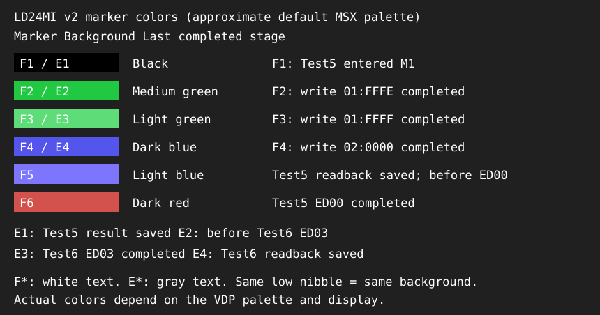

# Z80X24 24bitメモリ間接転送(ED00/01/03/08) 実機検証テスト (LD24MI.COM)

MSXnano-Z80X ([msxnano-24bit](../..) リポジトリ、24bit CPU拡張 "Z80X24") の、
2026-10-19に新規実装した24bitメモリ間接転送命令(`ED00`/`ED01`/`ED03`/`ED08`)を、
実機(Tang Nano)またはMSXエミュレータ上のMSX-DOS(2)から起動して確認するための、
Z80アセンブリ製テストプログラムです。

同じシナリオを検証するGHDLシミュレーション版テストベンチが
`msxnano-24bit/fpga/G80A/test/tb_ld24_mem_indirect.vhd` にあります。本プログラムは
それに対応するアドレス・期待値を使います。ただしDOS・割込み・表示処理は
命令単体のテストベンチには含まれないため、実行環境は同一ではありません。

## v2 MODE-SAFE (2026-10-20)

旧版はM1・非ゼロのバンク値を維持したまま比較処理とBDOSを実行し、
割込みも許可していました。比較対象やDOS内部の間接アクセスが別バンクへ
向かう不備があり、旧版のFAILだけからLD24本体の不具合とは判断できません。

修正版は各テストを次の順序で実行します。

1. `DI` → `SET_M1`。
2. データ準備・対象命令実行・結果とバンク値をbank00の絶対アドレスへ保存。
3. `SET_M0` → 使用したBC/DE/HL/IX/IYバンクをクリア → `EI`。
4. M0で比較・カウンタ更新・BDOS出力。

Test1/2/5には、LD24を実行する前に通常の`LD A,(BC)`で準備データを
読み戻す`setup byte-readback`判定を追加しました。これもFAILする場合は、
LD24だけでなく通常の1byteアクセス／データ準備経路も調査対象です。
Test_Fは比較結果をDOS出力で上書きしないよう、出力後に比較して直ちに分岐します。
画面色マーカーは割込み禁止中に書き込み、文字色を白に維持します。

## このプログラムを作成した目的

[PUSH24_POP24_bank境界またぎバグ_調査レポート.md](../../doc/jpn/PUSH24_POP24_bank境界またぎバグ_調査レポート.md)
で継続調査中の、PUSH24/POP24が64KBバンク境界をまたぐ際に実機でデータ破損・
フリーズを起こすバグの原因切り分けのために作成しました。

`ED00`/`ED01`/`ED03`/`ED08`は、PUSH24/POP24と全く同じ「LOW/HIGH/BANKの3byte・
境界またぎ時のbank自動繰上げ」という性質を持ちながら、MSP24専用のハードウェア
機構(`bank_msp_r`の自動増減ロジック)を**一切経由しない**、新設の`aXfer`アドレス
ソースによる独立したアドレス生成経路を使います(詳細は
[AVAILABLE_INSTRUCTIONS.md](../../AVAILABLE_INSTRUCTIONS.md)セクション18、
[t80.vhd](../../fpga/G80A/t80.vhd)の`aXfer`関連コメント参照)。

- もし本プログラムのTest5/Test6(境界またぎ)がPUSH24/POP24と同様のデータ破損を
  示せば、バグの所在はMSP24固有のロジックではなく、CPU/SDRAMコントローラの
  より一般的な部分にあることが強く示唆されます。
- 逆に本プログラムが全てPASSすれば、MSP24の`aMSP`アドレス生成経路・
  `bank_msp_r`増減ロジック自体に問題が局在している可能性が高まります。

## 必要な環境

- Windows
- Z88DK (`D:\Tool\z88dk` にインストールされている想定)
- `z88dk-z80asm` / `z88dk-appmake`
- `make` (GnuWin32 make等)
- 実行環境としてZ80X24拡張済みMSXnano実機、またはMSX-DOS(2)が動くMSXエミュレータ

PowerShellで現在のターミナルだけPATHへ追加する場合:

```powershell
$env:Path += ";D:\Tool\z88dk\bin"
```

## ビルド

`Ld24MemIndirectTest` フォルダで実行します。

```powershell
make
```

`bin\ld24mi.com` が生成されます。中間ファイルは `obj` と `BINZ80` フォルダに
生成されます。`make clean` で中間ファイルを削除できます。ビルドはこの環境で
実際に実行し、エラー・警告なくアセンブルできることを確認済みです。

`build.bat` は `z80asm` を直接呼び出す簡易スクリプトです(標準のビルド手順は
`make` です)。

## MSX上での実行

`bin\ld24mi.com` をMSXまたはエミュレータのディスクイメージ(または実SDカード)
へコピーし、MSX-DOSから実行します。

```text
A>LD24MI
```

実行ファイル名はMSX-DOSの8.3形式に合わせて `LD24MI.COM` としています。
**今回の変更はテストプログラムだけです。ED00/01/03/08実装済みのFPGAなら、
FPGAの再ビルド・書込みは不要で、COMの差替えだけで実行できます。**

起動時に次の識別バナーが出ることを確認してください。

```text
Z80X24 LD24 mem-indirect v2 MODE-SAFE
```

全項目が成功した場合、最後に次の表示が出てDOSへ戻ります。値は16進数です。

```text
PASS=13 FAIL=00
```

19判定 = 従来の10判定 + Test1/2/5の準備データ読み戻し3判定
+ Test1〜6の読み書きパターン試験6判定です。

### 読み書きパターン試験 (`Test1〜6 R/W patterns`)

各テストの冒頭(DI/M1中)で、使用する3byteについて次の6段階を順に行います。
各段階では、3byteを書いてから3byteを読み戻して比較します。

| 段階 | 書く値 |
|---|---|
| 1 | `00 00 00` |
| 2 | `FF FF FF` |
| 3 | `55 AA 55` |
| 4 | `AA 55 AA` |
| 5 | 最後に残す値のビット反転 |
| 6 | 最後に残す値 |

- 読出し系(Test1/2/5)は、最後に正解データを残してからLD24を実行します。
- 書込み系(Test3/4/6)は、最後に**期待値のビット反転**を残してからLD24を実行します。
  前回の実行結果が残っていても、ED03/ED08の書込みが消失すればFAILします。
- FAIL時は最初に不一致となった段階の`got`/`want`と`first failing step=nn`を表示します
  (`got`/`want`は他の判定と同じく3byte目,2byte目,1byte目の順)。
- Test5/6は`01:FFFE`,`01:FFFF`,`02:0000`の境界をまたぐ3byteで行います。

FPGA書込み直後の初回実行で、Test1の最初の2件が`got=xxCCCC`で
一度FAILしたことへの切り分けとして追加しました。

## 検証内容

| テスト | 対象命令 | 内容 |
|---|---|---|
| Test1 | `ED00` | `LD24 BC,(HL)` 通常アクセス(境界またぎ無し)。HL24=01:9000hの3byte(AAh,99h,05h)をBC24へロード。BC24=05:99AAhになること、HL24自体が不変なことを確認 |
| Test2 | `ED01` | `LD24 DE,(HL)` 通常アクセス(境界またぎ無し)。HL24=01:9010hの3byte(11h,22h,33h)をDE24へロード。DE24=33:2211hになること、HL24自体が不変なことを確認 |
| Test3 | `ED03` | `LD24 (HL),BC` 通常アクセス(境界またぎ無し)。BC24=EE:1234hをHL24=01:9020hへ書込み、(BC)間接読出しで実際の書込み内容を確認 |
| Test4 | `ED08` | `LD24 (HL),DE` 通常アクセス(境界またぎ無し)。DE24=9A:5678hをHL24=01:9030hへ書込み、同様に確認 |
| **Test5** | **`ED00`** | **64KBバンク境界またぎ読込み(最重要)。HL24=01:FFFEhの3byte(CDh,ABh,07h、3byte目がbank01h→02hへ境界またぎ)をBC24へロード。BC24=07:ABCDhになること、HL24自体が(繰り上がらず)01:FFFEhのまま変化しないことを確認** |
| **Test6** | **`ED03`** | **64KBバンク境界またぎ書込み(最重要、Test5の書込み版)。HL24=01:FFFEh、BC24=42:BEEFhを書込み、01:FFFEh=EFh/01:FFFFh=BEh/02:0000h=42h(境界またぎ)が実際に書き込まれたことを確認** |
| Test_F | `ED00` | 前後でF(フラグ)レジスタが変化しないことを確認 |

Test5/Test6(境界またぎ、最も実機フリーズ/データ破損のリスクが高い箇所)の
前後には、Push24Testと同じ診断用の画面背景色マーカー(VDP R#7への直接OUT)を
配置しています。万一フリーズが発生した場合、最後に表示されていた背景色から
どこまで実行が進んでいたかを特定できます。マーカー番号と対応する処理は
[ld24_mem_indirect_test.asm](ld24_mem_indirect_test.asm)のコメントを参照して
ください。

v2の後半マーカー値は次のとおりです。



| 値 | 背景色番号 | 背景色 | 文字色 | 到達済みの処理 |
|---|---|---|---|---|
| F1 | 1 | 黒 | 白 | Test5でM1へ入った直後 |
| F2 | 2 | 緑（中緑） | 白 | `01:FFFE`書込み完了 |
| F3 | 3 | 明るい緑 | 白 | `01:FFFF`書込み完了 |
| F4 | 4 | 濃い青 | 白 | `02:0000`書込み完了 |
| F5 | 5 | 明るい青 | 白 | 準備データ読戻し保存済み、Test5 ED00実行前 |
| F6 | 6 | 濃い赤 | 白 | Test5 ED00実行完了 |
| E1 | 1 | 黒 | 灰 | Test5結果回収完了 |
| E2 | 2 | 緑（中緑） | 灰 | Test6 ED03実行前 |
| E3 | 3 | 明るい緑 | 灰 | Test6 ED03実行完了 |
| E4 | 4 | 濃い青 | 灰 | Test6結果回収完了 |

VDP R#7の上位4bitが文字色、下位4bitが背景色です。
**F2とE2、F3とE3などは同じ背景色で、背景だけでは区別できません。**
上の見本は標準MSXパレットの近似で、実際の色はパレット・表示環境で異なります。

最後の行が`Test4 ... PASS`で、その後が緑なら、Test5中のF2/F3が候補です。
F2なら最初の書込み後から次のマーカーまで、F3なら2番目の書込み後から
次のマーカーまでの区間を調べます。色だけで停止命令や原因は断定できません。
Test5の結果表示も済んでいれば、Test6のE2/E3も候補になります。

- `F1`: Test5でM1へ入った直後
- `F2`: `01:FFFE`書込み完了
- `F3`: `01:FFFF`書込み完了
- `F4`: `02:0000`書込み完了
- `F5`: Test5のED00実行直前
- `F6`: Test5のED00実行直後
- `E1`: Test5の結果回収完了
- `E2/E3/E4`: Test6の実行前/実行直後/結果回収完了

## 実機安全性についての注意: FFFFFFhラップアラウンド試験は含めていません

GHDLシミュレーション版(`tb_ld24_mem_indirect.vhd`)にはTest9として、
HL24=FFh:FFFEhから3byte目がbank FFhからbank00hアドレス0000hへラップアラウンド
する試験が含まれていますが、bank00hはMSX互換の既存64KB空間(実行中の本プログラム
自身やMSX-DOS/BIOSが置かれている領域)をSD-RAM拡張メモリ経路を経由せず直接
参照するため、この試験を実機でそのまま行うと実行中のプログラムコードや
BIOSワークエリアを誤って破壊しかねません。GHDLシミュレーション(閉じた仮想
メモリ空間)でのみ安全に検証可能な項目と判断し、本プログラムには含めていません。

## 実機検証状況

2026-10-22のRTL修正では、CPUラッパ直後で通常MSXメモリバスと拡張メモリバスを
分離しました。旧RTLではTest5準備の`01:FFFF`書込みが通常MSX空間の
拡張スロット選択レジスタにも届く条件がありました。修正後は非ゼロバンクの
通常MSXメモリ要求を遮断します。詳細と回帰試験は
[SDRAMメモリマップ 4.1](../../doc/jpn/SDRAMメモリマップ.md#41-通常msx空間と拡張メモリのバス分離-2026-10-22)を参照してください。
**このRTL修正を試す場合はFPGAの再ビルド・書込みが必要です。COMの変更は不要です。**
**2026-10-22実機結果: バス分離RTLとv2 MODE-SAFE COMで`PASS=0D FAIL=00`、
フリーズなしで完了しました(反転パターン判定追加前の13判定版)。**
FPGA書込み直後の初回実行でTest1の最初の2件が`got=xxCCCC`でFAILしたことが
一度あり、読み書きパターン試験付きの19判定版でリセット後のFAILを再現しました。
要求受理RTLの修正後は、2026-10-23の実機報告でリセット直後も
`PASS=13 FAIL=00`が安定して得られています。

- 旧版: 2026-10-20実機でTest1〜4のFAILとフリーズを報告。
  モード管理の不備があるため、命令本体の不良との切り分けが必要です。
- v2 MODE-SAFE: ビルドと下記シミュレーションに合格し、実機でも合格しました。

### SDRAM要求受理タイミングの切り分け (2026-10-23)

実機ログ`RESULT.TXT`/`RESULT1.TXT`/`RESULT2.TXT`はいずれも、リセット後に
Test1の段階1で`got=0599AA, want=000000`、集計`PASS=12 FAIL=01`でした。

リポジトリルートから次で要求受理の競合を再現できます(Icarus Verilogが必要)。

```powershell
& .\fpga\G80A\test\run_cpu_sdram_request_timing.ps1
```

このテストは`top.v`から実際の要求/WAITブロックを抽出し、実際の`memory_ctrl`へ
接続します。修正前は、メモリ調停が待機中なら`659000`への書込みを正しく受理しましたが、
通常MSX側要求で受理段階へ進んだ直後に拡張要求が来ると、CPU優先の選択が
更新前のラッチ値を取り込み、意図した`address=659000 write=1`が
`address=000000 write=0`として受理されることを確認しました。

RTL修正では、`top.v`の要求出力を`WS_WAITING_DONE`中だけ有効にしました。
これにより、`WS_ARMED`でアドレスと書込み種別を確定する前に、
メモリ調停回路が拡張要求を受理することを防ぎます。
また`memory.v`では、通常MSX側アクセス終了時に未受理の拡張要求が
待機状態への復帰を妨げないよう、完了待ちのCPU要求を所有者で限定しました。

現在のテストは修正後の回帰試験です。読出し/書込みそれぞれについて、
待機中の到着と、通常MSX側受理段階から0〜7クロック後の到着を確認します。
全18ケースでアドレス・書込み種別、完了時のWAIT解除、完了後にバスが
アクティブのままでも二重発行しないことを確認しました。
Z80X24版と標準版のGowin論理合成も成功しました。

**実機確認にはFPGAの再ビルド(配置配線・ビットストリーム生成)と書込みが必要です。**
COMは変更せず、同じ19判定版LD24MIをリセット直後に実行してください。
期待結果は`PASS=13 FAIL=00`です。リセット→初回実行を複数回確認し、
併せてP24TESTの`PASS=0D FAIL=00`も確認してください。

2026-10-23実機結果: 修正FPGAで、リセット直後も`PASS=13 FAIL=00`が
安定して得られることを確認しました(ユーザー報告)。
CPU命令列・実際の映像クロック位相・物理SDRAMはこのRTL回帰試験では再現しておらず、
実機内部波形で3byteすべての失敗経路を直接観測したわけではありません。
原因・修正・eZ80実装への教訓とnote記事構成案は
[解決レポート](../../doc/jpn/24bit拡張メモリ_バス分離と要求受理競合_解決レポート_2026-10-23.md)
にまとめました。

### COM実行回帰の内容

[tb_ld24mi_com.vhd](../../fpga/G80A/test/tb_ld24mi_com.vhd)は生成したCOMを
T80上で直接実行し、比較・数値表示・集計・DOS終了まで検証します。
BDOSの0/2/9番を簡易スタブで実行し、スタブはBC/DE/HLとフラグを意図的に
破壊します。周期的なIM1割込みも発生させ、M1中の割込み禁止と
M0でのBDOS実行・割込み受付をアサーションで確認します。

- 通常: `PASS=13 FAIL=00`で正常終了。
- `01:9000`の読出しを故意に`00`へ変更: パターン試験の段階2
  (`got=FFFF00, want=FFFFFF`、`first failing step=02`)、準備読戻しとTest1
  (`got=059900, want=0599AA`)がFAILし、`PASS=10 FAIL=03`で正常終了。
- 既存の`tb_ld24_mem_indirect`も合格。

実MSX-DOS/BIOS、物理SDRAM、実機のWAIT調停そのものを再現するテストではありません。
リポジトリルートからの実行例 (GHDLとビルド済みCOMが必要):

```powershell
$work = Join-Path $env:TEMP "ld24mi-ghdl"
New-Item -ItemType Directory -Force $work | Out-Null
Set-Location fpga\G80A
ghdl -a --std=08 --workdir=$work t80_pack.vhd t80_mcode.vhd t80_alu.vhd t80_reg.vhd t80.vhd test\tb_ld24mi_com.vhd
ghdl -r --std=08 --workdir=$work tb_ld24mi_com '-gCom_File=..\..\hardware_test\Ld24MemIndirectTest\bin\ld24mi.com' --assert-level=error --ieee-asserts=disable-at-0
ghdl -r --std=08 --workdir=$work tb_ld24mi_com '-gCom_File=..\..\hardware_test\Ld24MemIndirectTest\bin\ld24mi.com' -gInject_Fault=true --assert-level=error --ieee-asserts=disable-at-0
```
